<div align="center">

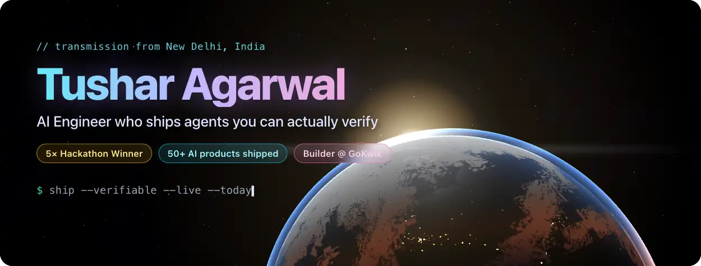

<a href="https://github.com/TusharTechs">
  
</a>

<p>
  <a href="https://www.linkedin.com/in/tushar-agarwal-2580971b3/"></a>
  <a href="https://devpost.com/TusharTechs"></a>
  <a href="https://tushar-uptime.vercel.app"></a>
  <a href="https://huggingface.co/TechTush"></a>
  
</p>

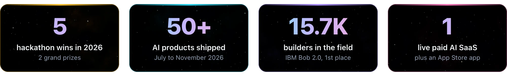

</div>

```yaml
name: Tushar Agarwal
role: AI Engineer · Customer Success Engineer @ GoKwik
based_in: New Delhi, India
builds: [multi-agent systems, RAG / GraphRAG, LLM evals, generative media]
believes: "An agent is only as good as the evidence it can show you."
signature_moves:
  - human-approval gates on anything irreversible
  - deterministic guardrails around probabilistic models
  - benchmarks with confidence intervals, not vibes
currently: shipping something new almost every week
```

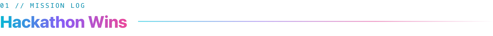

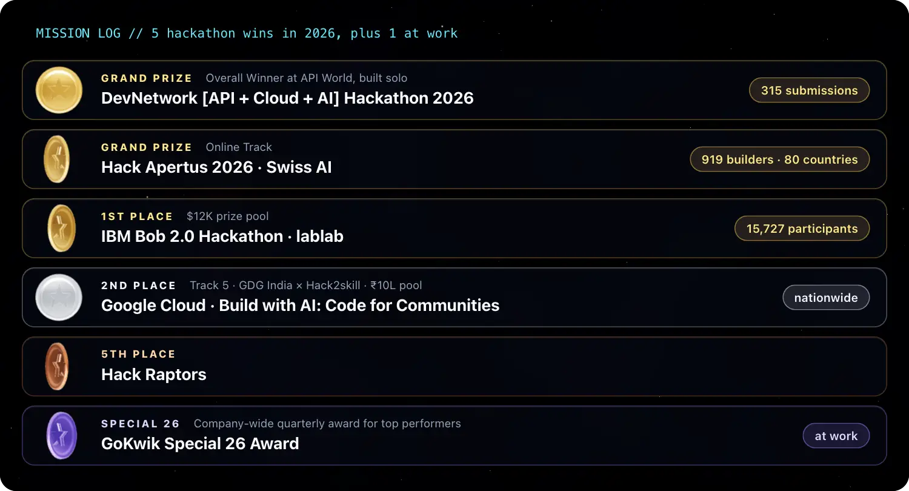

<p align="center">
  <b>The winning builds:</b>
  <a href="https://github.com/TusharTechs/aegisflow">AegisFlow</a> ·
  <a href="https://github.com/TusharTechs/sturmglocke">Sturmglocke</a> ·
  <a href="https://github.com/TusharTechs/amend">Amend</a> ·
  <a href="https://github.com/TusharTechs/aurora-lifeline">Aurora Lifeline</a>
</p>

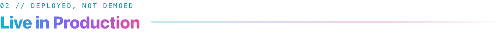

<table>
  <tr>
    <td width="50%"><a href="https://worldsmith-713583786482.us-central1.run.app/">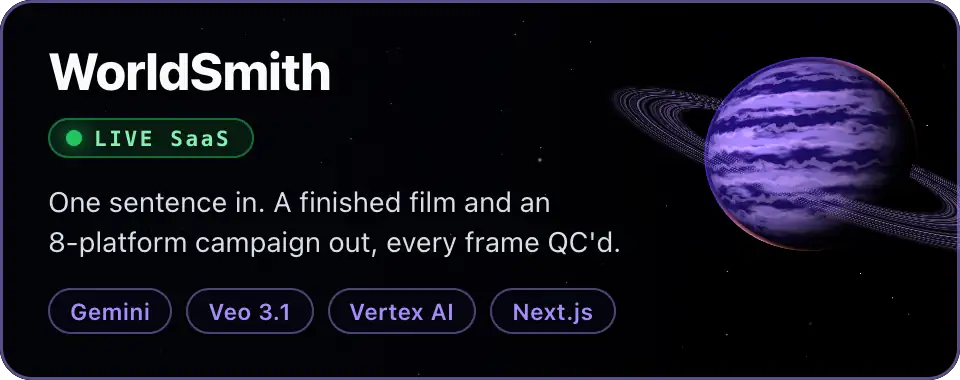</a></td>
    <td width="50%"><a href="https://mutiny-verify.vercel.app">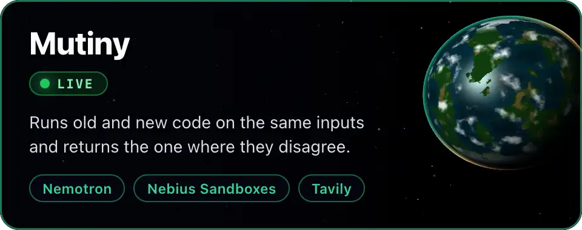</a></td>
  </tr>
  <tr>
    <td width="50%"><a href="https://107-191-39-70.sslip.io">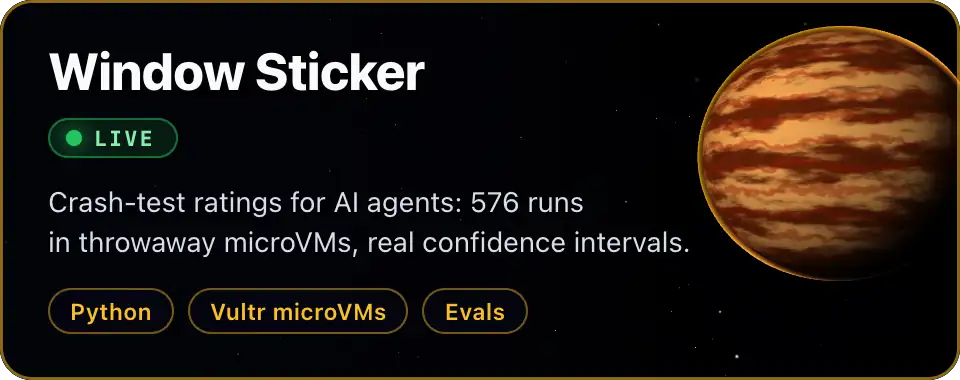</a></td>
    <td width="50%"><a href="https://d3luufd5s1g5pn.cloudfront.net">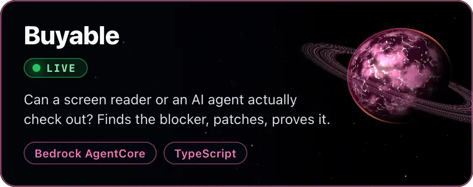</a></td>
  </tr>
  <tr>
    <td width="50%"><a href="https://staycovered.vercel.app/">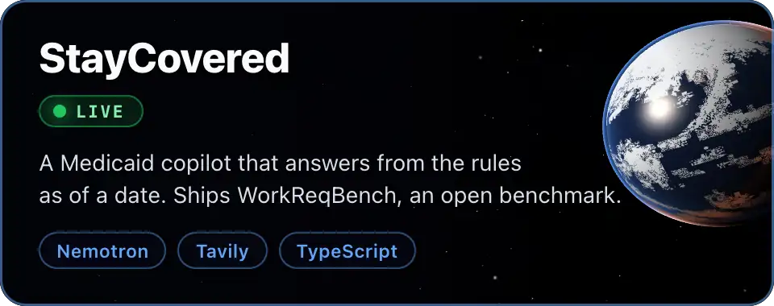</a></td>
    <td width="50%"><a href="https://huggingface.co/spaces/TechTush/rangrez">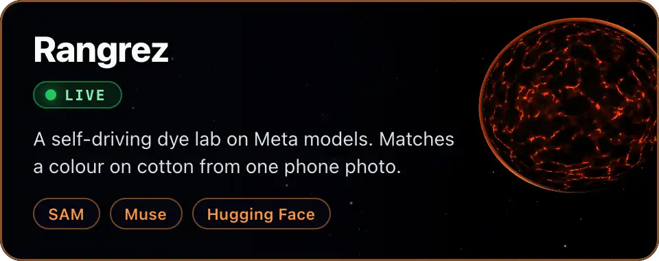</a></td>
  </tr>
  <tr>
    <td width="50%"><a href="https://apps.apple.com/app/dryrun-say-the-hard-thing/id6811369238">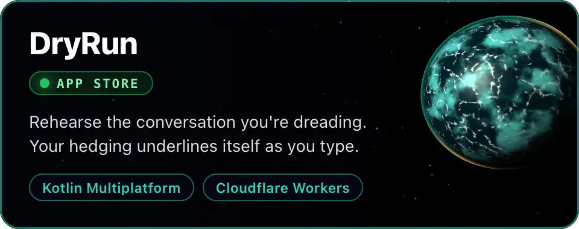</a></td>
    <td width="50%"><a href="https://github.com/TusharTechs/platelock">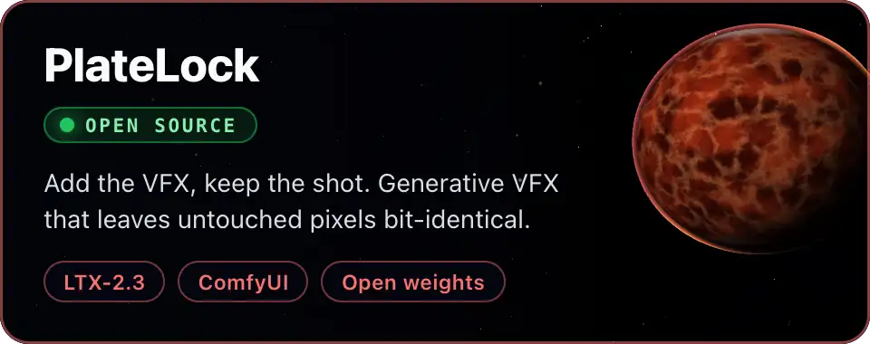</a></td>
  </tr>
</table>

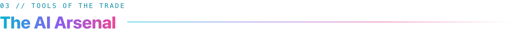

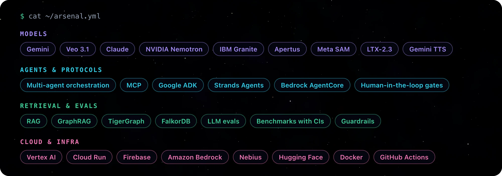

<p align="center">
  
</p>

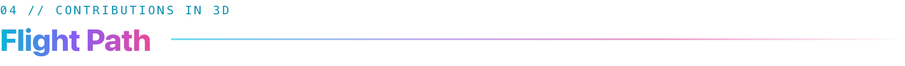

<p align="center">
  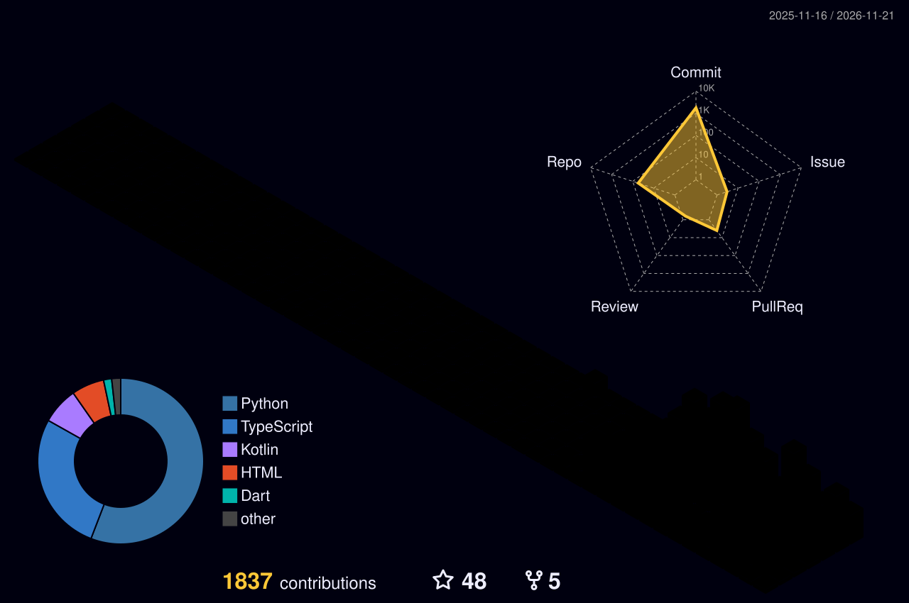
</p>

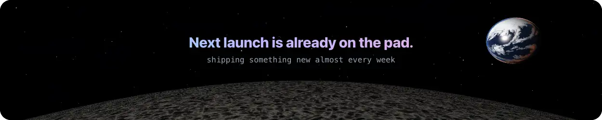

<p align="center"><sub>Every visual on this page is a real 3D render: Three.js scenes with NASA Blue Marble and Black Marble Earth textures, captured frame by frame into looping WebP. The source is in <a href="render">/render</a>.</sub></p>
